# Terrain3D Path

Paint paths and roads onto [Terrain3D](https://github.com/TokisanGames/Terrain3D) in Godot 4. Draw a curve, pick a style, and it follows the terrain and blends at the edges.

| | | | |
|---|---|---|---|
| 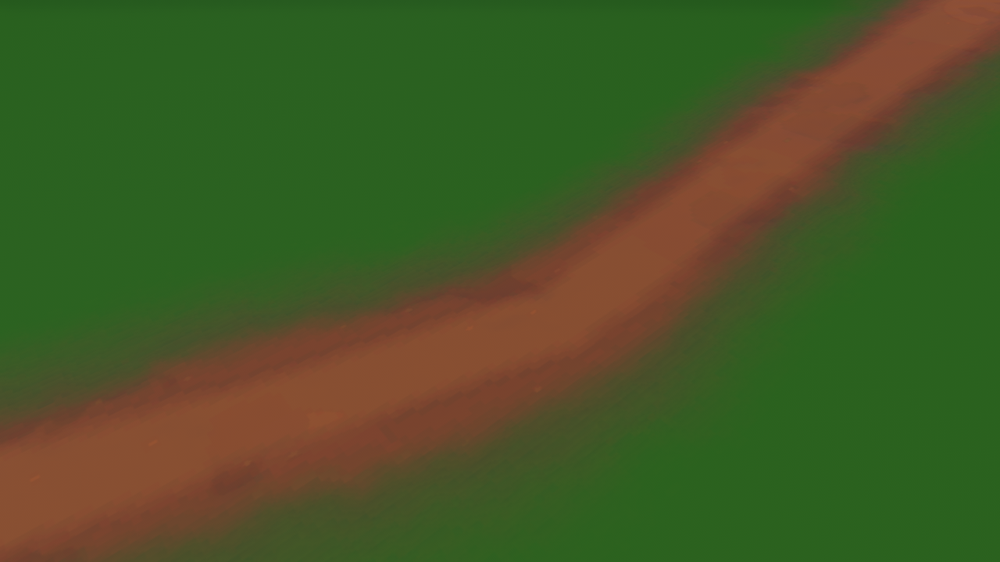 | 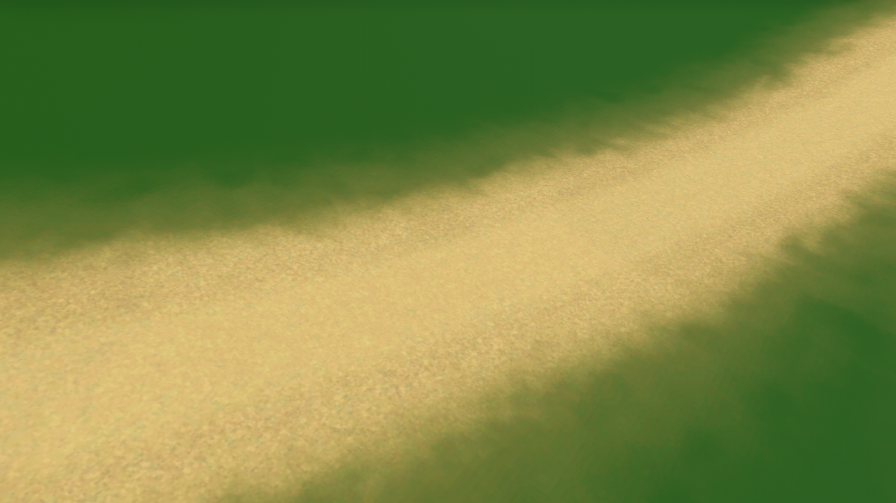 | 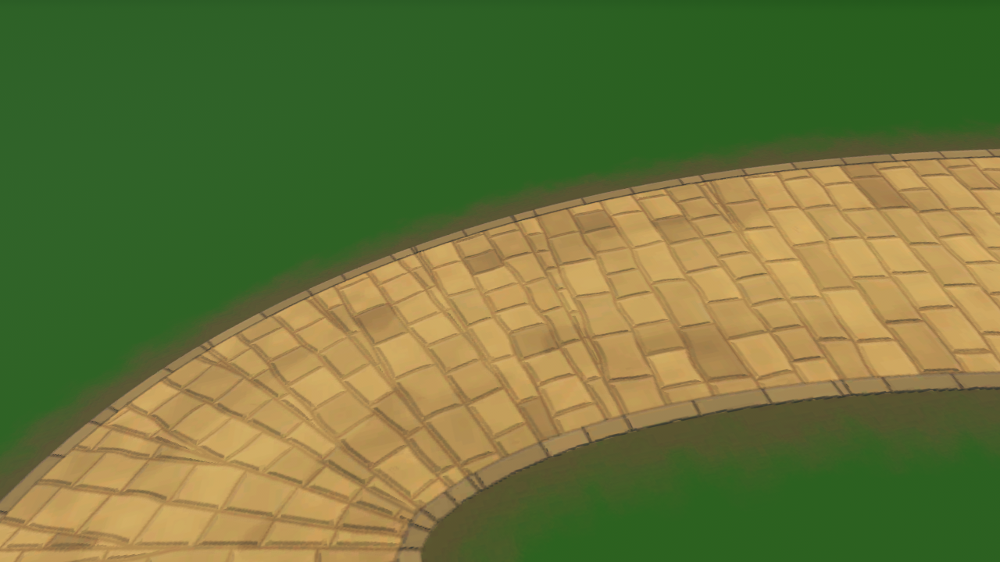 | 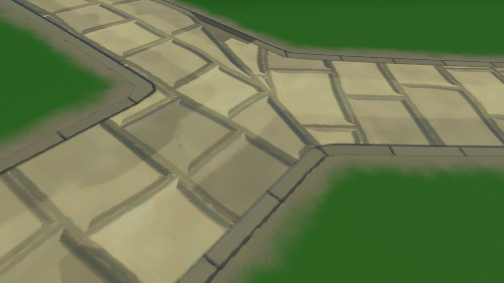 |
| Woodland mud | Country gravel | City paving | City slabs |
| 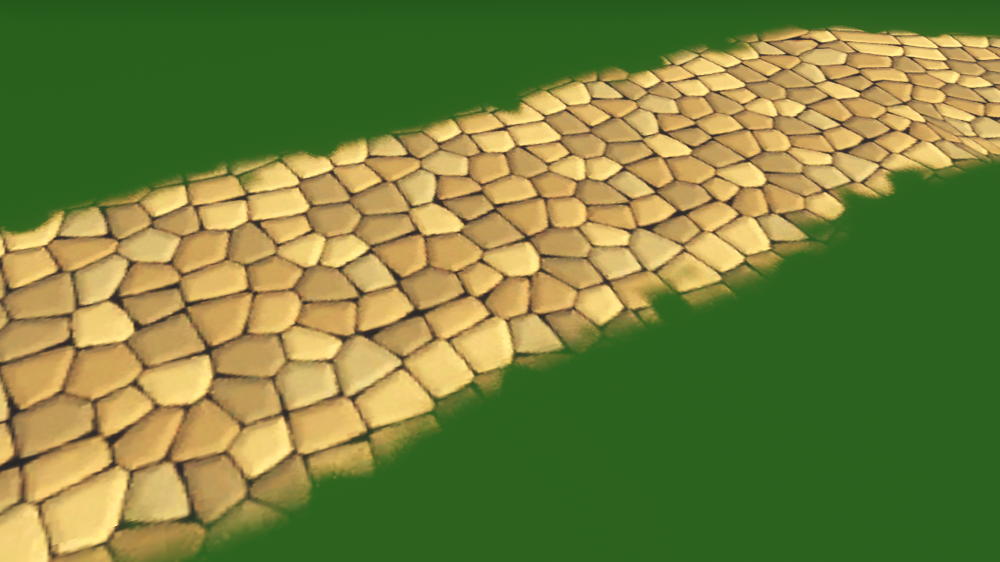 | 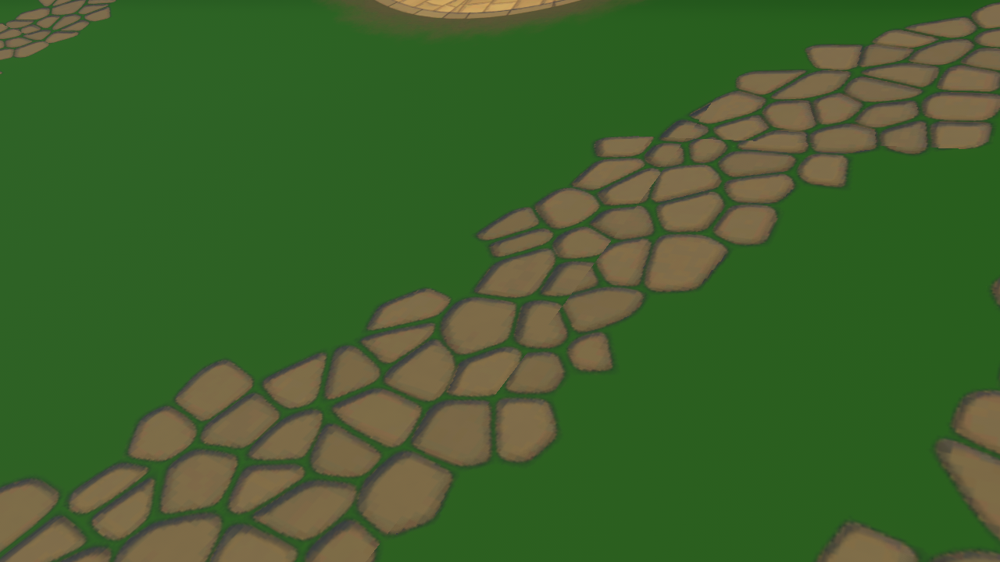 | 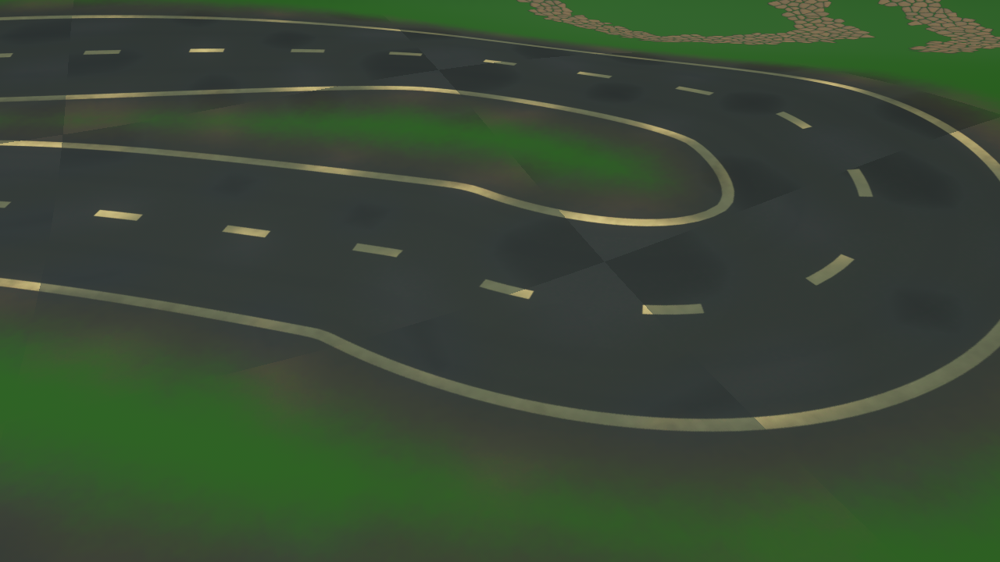 | 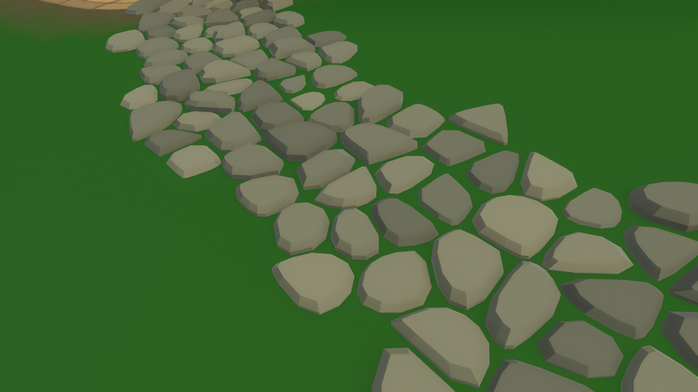 |
| Cobbles | Stones | Road | 3D stones (PathScatter) |

> **Work in progress.** I'm building this for my own game and sharing it as I go, so things may change or break between versions. It's supplied as-is with no support promised, though I'll look at issues when I can.

## What it does

- Seven ready-made styles: woodland mud, country gravel, city paving, city slabs, cobbles, stones and a road with markings
- Paths follow the terrain, and you can snap the points down onto it from the toolbar
- Branches, crossroads and end-to-end joins merge into one surface
- Round, square or feathered ends, so one path can fade into another
- Every style is a resource, so you can recolour or retune any of them
- `PathScatter` lays real 3D stones along a path instead of painting them

| | | |
|---|---|---|
| 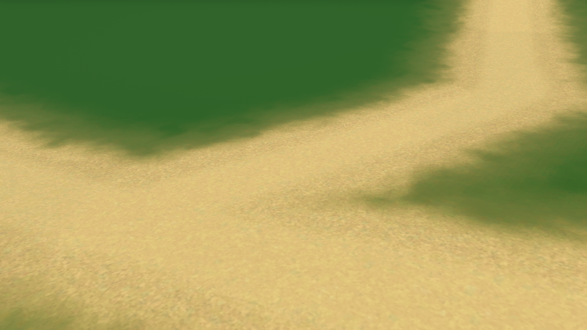 | 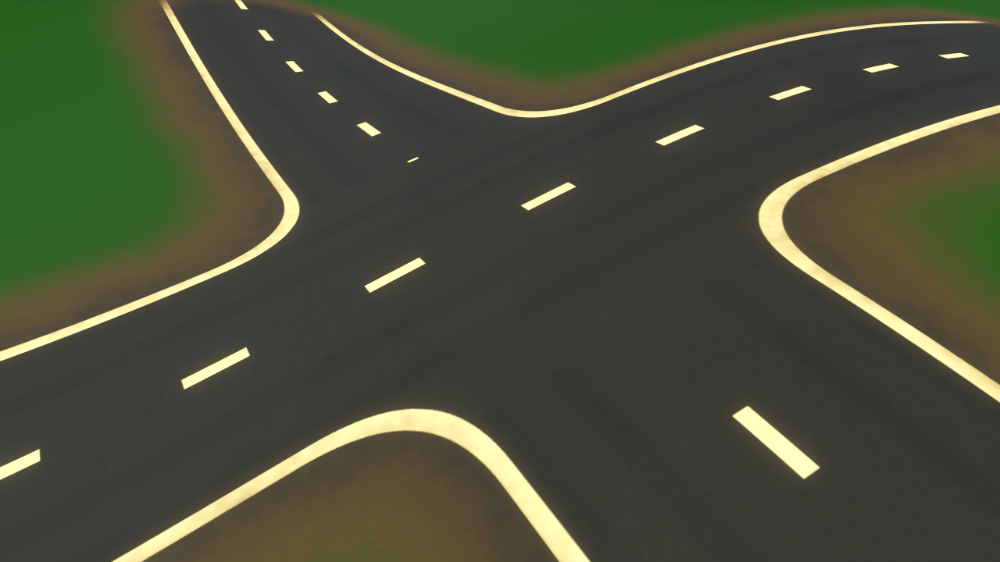 | 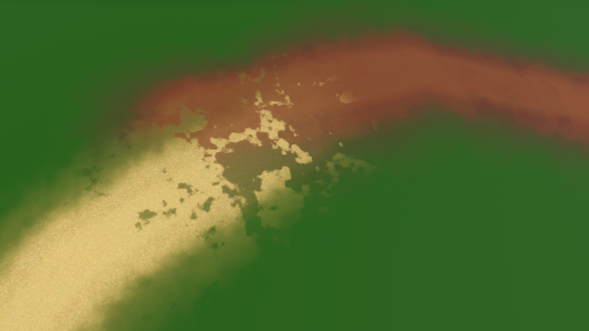 |
| Branch | Crossroads | Path blending |
| 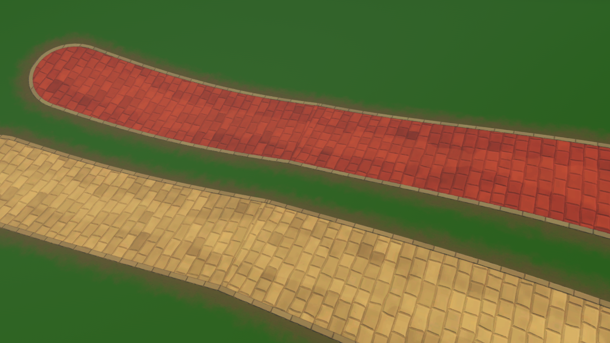 | 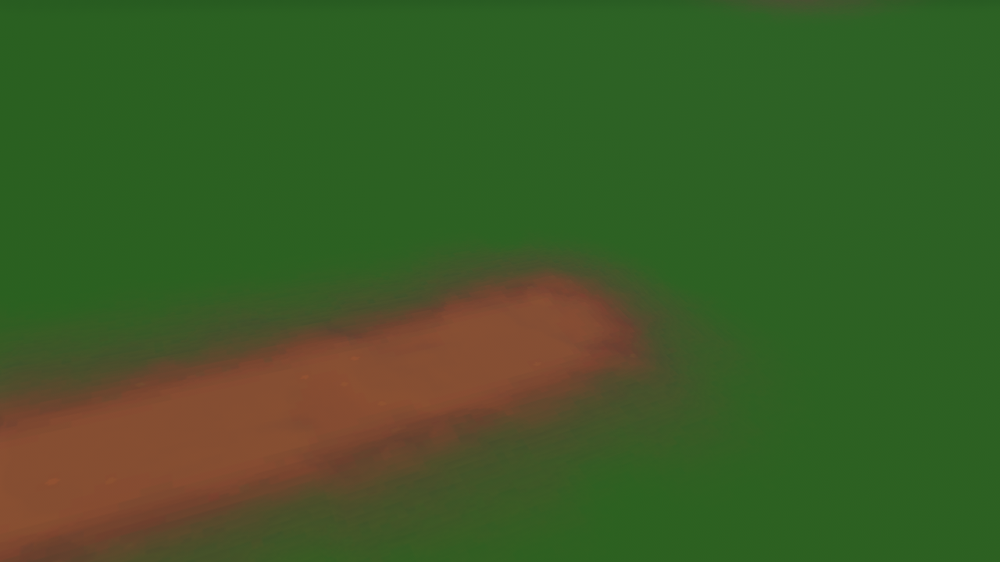 | 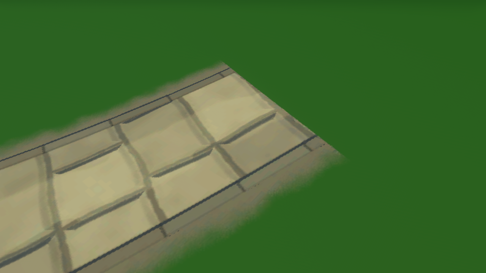 |
| Recolour: default vs brick | Round end | Square end with edging |

## Requirements

- Godot 4.6 or later (tested on 4.6 and 4.8)
- Terrain3D 1.1. Without a Terrain3D in the scene paths just follow the curve's own height

## Install

1. Install Terrain3D first if you haven't
2. Copy `addons/terrain_paths` into your project's `addons` folder
3. **Project → Project Settings → Plugins** and tick **Terrain3D Path**. The path nodes work without it, the plugin only adds the snap button

## Step by step

**1. Add a path**

- In a scene with a Terrain3D, **Add Node** and search "Path"
- Pick one: `WoodlandPath`, `GravelPath`, `CityPath`, `CitySlabPath`, `CobblePath`, `StonePath` or `RoadPath`. Plain `TerrainPath` has no style, drop your own into **Style**
- Leave the node at the origin

**2. Draw it**

- Select the node and use Godot's Path tools in the 3D toolbar to click points. Top-down is easiest
- If the points land in the wrong place press **Snap Path To Terrain** in the toolbar, or tick **Snap Points To Terrain** in the inspector

**3. Tweak it**

- **Width** on the node, 0 uses the style's default
- Everything else lives in **Style**: colours, pattern, edges, wear, bump, edging, road markings and the end style
- Each new path gets its own copy of its style, so changing one doesn't touch the others. To reuse a look, save the style as a `.tres` and load it on the other paths

**4. Branches and crossroads**

- Add a `TerrainPath` as a **child** of another path and draw it starting on the parent. It takes the parent's style and is baked into the same surface
- Draw it right across the parent for a crossroads
- **Style → Junction Radius** rounds the corners where they meet. On roads the higher **Draw Order** keeps its markings through the junction

**5. Joins and blends**

- Two paths whose ends are within 0.6 m butt together on a shared mitre
- To fade one style into another, overlap them, set **Style → End Style** to **Feathered** on the one that should fade and give it the higher **Draw Order**

**6. 3D stones**

- Add a `PathScatter` as a child of any path. It hides the paint and lays stones instead
- With **Pieces** empty it makes its own stones, tuned under **Made Stones** (gap, height, bevel, colour). Drop your own tile scenes into **Pieces** and a **Tiles** group shows instead
- **Size** scales the stones either way, **Sink** sets how far they sit into the ground, **Round Corners** smooths sharp corners on the path

## Notes

- Paths are painted over the terrain, so things walk on them using Terrain3D's own collision. `PathScatter` stones have no collision of their own
- The first time you run a scene, its paths save their finished look into a `path_bake` folder next to it, so they load faster after that. Leave it in your project. If a path ever looks out of date, delete the folder and it rebuilds
- Each style has a **Surface Tag** (`mud`, `gravel`, `cobble`, `paving`, `road`). The addon doesn't use it, it's for your game, e.g. footstep sounds:
  ```gdscript
  # in your player script
  @onready var step_sounds := {   # surface tag -> function to call
  	"gravel": play_gravel_step,
  	"mud": play_mud_step,
  	"cobble": play_stone_step,
  }

  # call this when a foot lands, e.g. from an AnimationPlayer method track on the walk cycle
  func on_footstep() -> void:
  	var tag := TerrainPath.surface_at(get_tree(), global_position)
  	# tag is "" off a path. anything not in step_sounds falls back to play_grass_step
  	step_sounds.get(tag, play_grass_step).call()
  ```
- Three optional hooks if your game needs them:
  - `TerrainPath.ground_fallback`: a `func(node) -> Object` with `get_height()` / `get_normal()` for scenes with no Terrain3D
  - `PathScatter.mesh_hook`: a `func(mesh_instance)` run on every stone mesh, e.g. to swap in your own shader
  - `TerrainPath.reshaped_hook`: editor only, a `func(path, area, first_build)` called when a path is built or edited. `area` is the world XZ `Rect2` it covered, handy for re-planting grass or trees round it

## Credits

Built on [Terrain3D](https://github.com/TokisanGames/Terrain3D) by Cory Petkovsek and Roope Palmroos.

## License

CC0, so use it however you like, commercial projects included, no credit needed.

One polite ask: please don't repackage and sell the addon on its own. If it's missing something you need, open an issue or a feature request instead and I'll happily take a look.
